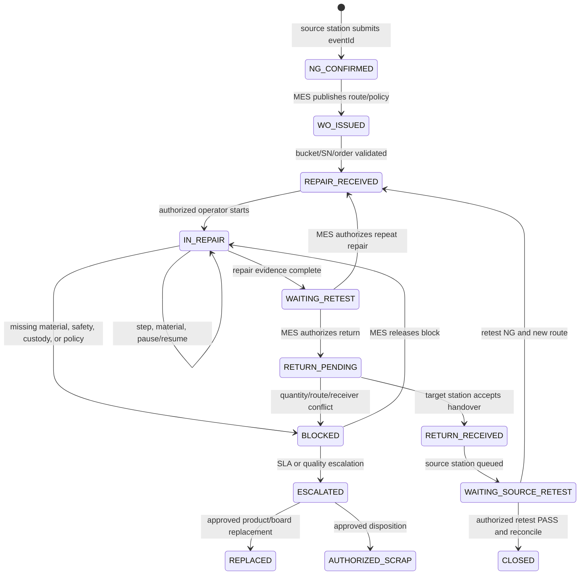

# Manual-line repair station: functions and workflow

**Document ID:** ML-REPAIR-STATION-001  
**Scope:** Manual-line repair station (`manu_rework`) and its MES-owned NG closed loop  
**Audience:** MES, repair-station, ICT/FCT/depanel agents, PDA, WMS/QMS, line and plant management  
**Authority:** MES is the system of record and route/permission authority. The repair station is an execution and evidence-collection client.

## 1. Operating contract

The station may scan, display, execute, and report. It must not invent a route, increase a retest limit, delete an NG event, scrap a product, or provide final product release. Every state-changing command has an `eventId`, actor, timestamp, station identity, host IP, source version, and MES acknowledgement.

When MES is online, commands are synchronous where possible. When MES is offline, the station may continue only with the last signed route policy and writes append-only records to the local Outbox. MES decides the final outcome after recovery.

## 2. Roles and responsibilities

| Participant | Responsibilities | Cannot do |
|---|---|---|
| MES | Owns product/NG state, routes, repair orders, retest limits, permissions, SLA, approvals, audit, conflict resolution | Be bypassed for final release |
| Repair station | Receives a work order, verifies custody, records repair facts/materials/evidence, requests authorized retest, reports completion | Change route, delete history, self-approve, self-scrap |
| Source station (ICT/FCT/depanel) | Produces test facts and NG evidence; receives authorized return and retests | Create an untracked return |
| Team/line leader PDA | Acknowledges pickup/return tasks, scans bucket and SN, confirms custody and quantity | Change MES routing or quality disposition |
| WMS | Confirms material identity, lot, quantity, issue/return transaction | Approve a repair result |
| QMS/QC | Approves controlled exceptions, severe defects, scrap, replacement, final quality decisions | Rewrite original evidence |
| Andon/notification | Escalates overdue, blocked, unacknowledged, or unsafe work | Close an alert without an accountable action |

## 3. Core objects

### 3.1 NG event

Immutable source fact containing `eventId`, product ID, SN(s), source station, work order, defect code, measurements, test file/image references, operator, equipment, result version, and occurred time. Corrections are new events linked by `supersedesEventId`.

### 3.2 Repair case

MES object that follows one NG from confirmation to disposition. Required fields: `repairCaseId`, `eventId`, product/SN/board relationship, current state, route revision, retest count/limit, priority/SLA, source/repair/return stations, bucket, quantity, owner, approvals, and audit trail.

### 3.3 Repair work order

MES instruction to perform work. It contains order number, issue time, source station, repair station, return station, product/SN, bucket QR, quantity, defect evidence, policy revision, allowed actions, material rules, retest authorization, due time, and status.

### 3.4 Bucket and handover

The bucket is a controlled carrier identified by QR. A handover binds bucket QR + station + quantity + SN list + work-order IDs + sender/receiver + time + location. A partial quantity requires a split record; quantity must reconcile before closure.

## 4. Station functions

### 4.1 Startup, identity, and health

1. Load signed station configuration: domain, line, station code, host IP, UI language set, MES endpoints, policy revision, and feature flags.
2. Verify local clock, SQLite schema, Outbox, scanner, camera, printer, WMS/QMS connectivity, and required folders.
3. Register heartbeat with MES: station code, IP, app version, config revision, process ID, resource status, last command/event, and alarm state.
4. Refuse production actions when identity, schema, or policy signature is invalid; show a clear alarm and recovery action.
5. Keep one watchdog/keep-alive process, but do not duplicate the GUI process.

### 4.2 Work-order inbox and queue

1. Pull assigned, waiting-receipt, in-progress, blocked, overdue, and return-pending work orders.
2. Sort by MES priority, SLA due time, safety/quality hold, source line, and FIFO tie-breaker.
3. Show the reason, route, quantity, bucket, allowed actions, and required approvals before acceptance.
4. Never accept an expired, cancelled, wrong-domain, wrong-station, or already received order.
5. Acknowledge assignment without changing the route; record `WORK_ORDER_VIEWED`.

### 4.3 Receive NG at repair station

1. Scan work-order QR, bucket QR, or SN.
2. Resolve the full case from MES; show source station, defect evidence, quantity, route, retest count, and SLA.
3. Validate SN/bucket/order/quantity consistency and duplicate receipt.
4. Validate that the repair station is an authorized destination and that no prior open repair order blocks receipt.
5. Record sender, receiver, time, location, quantity, and custody signature.
6. Transition `WO_ISSUED -> REPAIR_RECEIVED`; otherwise create a blocking event and Andon escalation.

### 4.4 Execute repair

1. Verify operator role and required training/authorization.
2. Start repair timer and capture station conditions.
3. Record diagnosis, disassembly, fault location, repair method, part replacement, solder/rework, cleaning/drying, and reassembly.
4. Scan every material and lot through WMS; record quantity, source, return/scrap, and reason.
5. Record tool/equipment/fixture IDs, measurements, images, files, and step timestamps.
6. Support pause, resume, blocked, abnormal stop, and handoff to another authorized operator.
7. Monitor SLA; warn at configurable thresholds and escalate overdue work to line manager/QC/engineering.

### 4.5 Request and perform retest

1. Check MES policy for allowed test, maximum retests, test version, and required approval.
2. Ensure all mandatory repair steps, materials, and evidence are complete.
3. Request a signed retest authorization; do not treat local PASS as final product PASS.
4. Execute ICT/FCT/aging/high-voltage or other authorized test and capture raw result, measurements, equipment, version, operator, and attachments.
5. Submit `RETEST_RESULT_RECORDED`; MES determines PASS, repeat repair, escalation, replacement, or scrap.

### 4.6 Return repaired NG

1. Create a return handover only after MES authorizes the destination.
2. Bind returned quantity and SN list to the bucket QR and return order.
3. Announce pickup to the team/line leader PDA and MES Kanban.
4. Record sender, receiver, time, location, and unresolved quantity.
5. Target station scans and validates the return; station jumping or quantity mismatch creates a block.
6. Complete the return transfer and leave the repair case in `WAITING_SOURCE_RETEST` until the source station reports.

### 4.7 Close or escalate

1. Close only when MES confirms the authorized source retest and all quantities reconcile.
2. Preserve original NG and every repair/retest attempt.
3. Escalate repeat NG, SLA breach, missing custody, material mismatch, route conflict, or offline conflict.
4. Only MES/QC/engineering roles may approve special release, replacement, scrap, destruction, or final disposition.

### 4.8 History, audit, and export

The station provides searchable history by SN, eventId, work order, bucket, defect, operator, station, and time. Exports include a manifest and immutable links to evidence, images, test files, material lots, approvals, and Outbox replay status. History is append-only and never overwritten.

## 5. State workflow

## 6. MES/API contract

All endpoints accept `eventId`, `correlationId`, `stationCode`, `hostIp`, `appVersion`, `configRevision`, actor, and an idempotency key. Responses include `accepted`, `nextState`, `policyRevision`, `serverTime`, and a human-readable reason.

| Operation | Endpoint | Result |
|---|---|---|
| Check NG/route | `GET /api/mes/ng-registry/check?sn=&callerStation=` | Current state, allowed destination, route revision, retest limit |
| List work orders | `GET /api/station/maintenance-work-orders` | Filtered queue and SLA |
| Work-order context | `GET /api/repair-station/context?workOrderNo=` | Product, defect, route, evidence, permissions |
| Receive handover | `POST /api/station/maintenance-handovers/receive` | Custody receipt or blocking reason |
| Repair command | `POST /api/repair-station/work-orders/{id}/commands` | Append repair fact; no local disposition |
| Material usage | `POST /api/station/maintenance-work-orders/{id}/materials` | WMS-linked issue/return record |
| Retest request/result | `POST /api/repair-station/work-orders/{id}/retest` | MES authorization and recorded result |
| Return handover | `POST /api/station/maintenance-handovers` | Return order, bucket binding, destination |
| Pickup announcement | `POST /api/mes/repair/pickup-announcements` | PDA/MES Kanban notification and acknowledgement |
| Heartbeat | `POST /api/stations/{stationCode}/heartbeat` | Health, version, IP, alarms |
| Offline replay | `POST /api/mes/outbox/replay` | Idempotent acceptance or conflict |

## 7. Offline and recovery rules

### Allowed while MES is offline

- Read the last signed route and retest policy.
- Scan, collect evidence, record repair steps/materials, and prepare a temporary handover.
- Write immutable local Outbox events with generated eventId and sequence number.
- Display offline status and prevent actions outside the cached policy.

### Forbidden while MES is offline

- Change route, add retests, add users, delete/overwrite NG history, final release, scrap, replacement, or destruction.

### Recovery

1. Reconnect and negotiate policy/config revision.
2. Replay Outbox in event order with idempotency keys.
3. Convert temporary work orders to official MES orders.
4. Raise conflicts for route/version/quantity mismatches; MES decides.
5. Keep the original local record and server response linked for audit.

## 8. Required persistence and audit tables

At minimum MES provides `ng_defect_records`, `repair_cases`, `station_repair_work_orders`, `station_route_requests`, `station_handover_transfers`, `station_bucket_snapshots`, `station_repair_steps`, `station_repair_material_usage`, `station_retest_results`, `station_production_events`, `ng_revival_audit`, `mes_alarm_processes`, `mes_alarm_events`, `station_heartbeats`, and `audit_events`. The station keeps SQLite `outbox_events`, `outbox_attempts`, `local_case_cache`, and `local_health_snapshots`.

Every table has a stable ID, event/correlation IDs, created/occurred/received times, source station, actor, policy/config revision, and append-only audit linkage.

## 9. Permissions and safeguards

- `operator`: scan, execute assigned steps, record evidence.
- `repair_lead`: pause/resume, assign authorized technician, request retest.
- `line_manager`: acknowledge pickup/Andon and receive custody.
- `qc_engineer`: approve controlled retest, severe NG, special disposition.
- `mes_admin`: publish routes, policies, limits, domains, and permissions.
- `auditor`: read/export only.

The UI must visibly show domain, station, route revision, online/offline state, policy age, current case, and blocked reason. Destructive actions require MES authorization, reason, and second-person approval where configured.

## 10. Acceptance and smoke tests

1. Startup rejects an invalid station identity and reports a heartbeat alarm.
2. Valid work order is received once; duplicate receive is rejected idempotently.
3. Wrong SN, bucket, source, route, quantity, or station jump is blocked and audited.
4. Repair steps, material lot, measurements, image, and operator are searchable by eventId.
5. Retest over the MES limit is rejected; local PASS cannot close the case.
6. Return handover binds bucket QR, quantity, SN list, sender, receiver, and target station.
7. PDA pickup acknowledgement and MES Kanban state update are correlated by eventId.
8. Offline mode writes Outbox and forbids route/retest/disposition changes.
9. Recovery replays idempotently and raises a policy conflict instead of overwriting history.
10. Repeat NG enters a new repair cycle while preserving all prior cycles.
11. SLA thresholds create Andon escalation and acknowledgement records.
12. Export contains the complete case timeline and evidence manifest.

## 11. Related documents

- [Manual-line repair queue](manual-line-repair-queue.md)
- [Manual-line repair work order](manual-line-repair-work-order.md)
- [Repair case lifecycle](repair-case-lifecycle.md)
- [NG pickup announcement](ng-pickup-announcement.md)
- [MES management closure matrix](management-system-closure-matrix.md)
- [Management-system integration graph](../smt-factory-system/docs/repair-station-functions-workflow.md)
