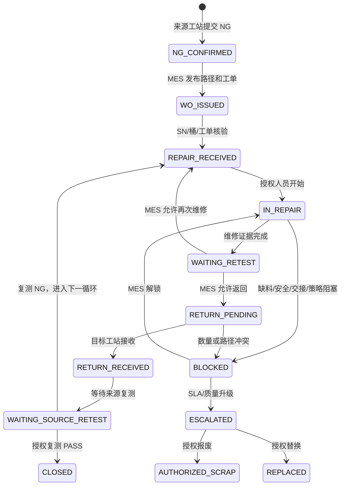

# 手动线维修站：功能与工作流

**文档编号：** ML-REPAIR-STATION-001  
**适用范围：** 手动线回修站（`manu_rework`）及 MES 管理的 NG 闭环  
**核心原则：** MES 是唯一的状态、路径、权限和最终处置权威；维修站 Agent 只执行授权动作并采集事实。

## 1. 运行约束

维修站可以扫描、显示、执行、记录和上报，但不得自行修改维修路径、增加复测次数、删除 NG、报废、替换或最终放行。每个改变状态的动作必须带有 `eventId`、操作者、时间、工站编码、主机 IP、应用版本、配置版本和 MES 回执。

MES 在线时按 MES 指令执行。MES 断线时只允许使用最后一次签名发布的策略，所有本地记录写入不可覆盖的 Outbox；MES 恢复后由 MES 裁决。

## 2. 参与方和职责

| 参与方 | 负责事项 | 禁止事项 |
|---|---|---|
| MES | 产品/NG 状态、路径、工单、复测上限、权限、SLA、审批、审计、冲突裁决 | 被 Agent 绕过 |
| 维修站 Agent | 接收工单、核验交接、记录维修/物料/证据、执行授权复测、上报完成 | 改路径、删历史、自行放行/报废 |
| ICT/FCT/分板等来源工站 | 产生测试事实和 NG 证据，接收授权返回并复测 | 无交接直接接收 |
| 组长/线长 PDA | 扫描桶和 SN、确认领取/接收、确认数量和交接 | 改 MES 路径或质量结论 |
| WMS | 物料、批号、数量、领用/退料 | 判定维修结果 |
| QMS/QC | 严重 NG、特批、报废、替换、最终质量审批 | 改写原始证据 |
| Andon | 超时、阻塞、无人响应升级 | 无责任人关闭报警 |

## 3. 核心对象

- **NG 事件：** 保存 `eventId`、产品/SN、来源工站、缺陷代码、测量值、测试文件、图片、设备、操作者和测试版本；原始记录不可覆盖。
- **维修案例：** MES 跟踪 NG 从确认到最终处置，包含当前状态、路径版本、复测次数/上限、来源/维修/返回工站、桶、数量、SLA、审批和完整审计链。
- **维修工单：** 包含工单号、签发时间、来源/维修/返回工站、SN、桶 QR、数量、缺陷证据、策略版本、允许动作、物料规则、复测授权和截止时间。
- **桶与交接单：** 将桶 QR、工站、SN 清单、数量、工单、发送人、接收人、时间、地点绑定；拆分数量必须建立拆分记录。

## 4. 维修站功能

### 4.1 启动、自检和心跳

1. 读取签名配置：域、产线、工站编码、主机 IP、语言、MES 地址、策略版本和功能开关。
2. 检查时间、SQLite、Outbox、扫描器、相机、打印机、WMS/QMS 通信和目录。
3. 向 MES 上报心跳：工站、IP、版本、配置版本、进程、资源、最后事件和报警状态。
4. 身份、数据库结构或策略签名无效时禁止生产操作并显示恢复指引。
5. 使用一个看门狗保持进程存活，不得启动重复 GUI。

### 4.2 工单队列

拉取待接收、维修中、待返回、阻塞、超时工单；按 MES 优先级、SLA 到期时间、质量/安全状态和 FIFO 排序。显示原因、路径、数量、桶、允许动作和审批要求。过期、取消、错误域、错误工站或已接收工单必须拒绝。

### 4.3 接收 NG

扫描工单 QR、桶 QR 或 SN；从 MES 读取完整案例；核验 SN、桶、工单、数量、来源和目标；检查重复接收、未关闭旧单和维修次数；记录发送人、接收人、时间、地点和数量；成功后进入 `REPAIR_RECEIVED`，失败则建立阻塞事件并触发 Andon。

### 4.4 执行维修

验证维修人员权限；开始计时；记录诊断、拆解、定位、维修方法、换件、焊接、清洁、烘干和组装；通过 WMS 扫描物料及批号；记录工具、设备、治具、测量值、图片和附件；支持暂停、继续、异常中止和交接；按 SLA 报警升级。

### 4.5 维修后复测

检查维修步骤、材料和证据是否完整；读取 MES 允许的测试类型、测试版本和最大次数；申请授权后执行 ICT/FCT/老化/高压等测试；记录原始结果、测量值、设备、版本、操作者和附件；本地 PASS 不能直接作为最终产品 PASS。

### 4.6 返回来源工站

MES 授权后创建返回交接单；将返回数量和 SN 与桶 QR 绑定；通知组长/线长 PDA 和 MES 看板；目标工站扫码核验；数量或路径不一致时阻塞；来源工站复测前案例保持 `WAITING_SOURCE_RETEST`。

### 4.7 关闭、重复维修和升级

只有 MES 确认来源复测、数量核对和权限审批完成后才能关闭。重复 NG 进入下一维修循环；超时、缺料、数量不一致、站点跳跃、路线冲突或无人处理必须升级。特批、替换、报废和销毁必须由 MES/QC/工程师授权。

### 4.8 历史、审计和导出

支持按 SN、`eventId`、工单、桶、缺陷、操作者、工站和时间查询；导出时间线、证据清单、图片、测试文件、物料批号、审批和 Outbox 回放状态。历史只追加，不覆盖。

## 5. 状态流转

## 6. MES 接口

所有接口携带 `eventId`、`correlationId`、工站、IP、版本、配置版本、操作者和幂等键；返回是否接收、下一状态、策略版本、服务器时间和原因。

| 业务 | 接口 |
|---|---|
| 查询 NG/路径 | `GET /api/mes/ng-registry/check?sn=&callerStation=` |
| 工单队列 | `GET /api/station/maintenance-work-orders` |
| 工单上下文 | `GET /api/repair-station/context?workOrderNo=` |
| 接收交接 | `POST /api/station/maintenance-handovers/receive` |
| 维修事实 | `POST /api/repair-station/work-orders/{id}/commands` |
| 物料记录 | `POST /api/station/maintenance-work-orders/{id}/materials` |
| 复测申请/结果 | `POST /api/repair-station/work-orders/{id}/retest` |
| 返回交接 | `POST /api/station/maintenance-handovers` |
| PDA 领取通知 | `POST /api/mes/repair/pickup-announcements` |
| 心跳 | `POST /api/stations/{stationCode}/heartbeat` |
| Outbox 回放 | `POST /api/mes/outbox/replay` |

## 7. MES 断线与恢复

断线允许读取最后签名策略、扫描、记录证据/维修/物料、生成临时交接并写入 Outbox；禁止改路径、增加复测、增加授权人员、最终放行、报废、替换、删除或覆盖历史。恢复后按事件顺序幂等补传，转换正式工单，发现版本/数量/路径冲突时报警并由 MES 裁决。

## 8. 必须的表和审计

MES 至少提供：`ng_defect_records`、`repair_cases`、`station_repair_work_orders`、`station_route_requests`、`station_handover_transfers`、`station_bucket_snapshots`、`station_repair_steps`、`station_repair_material_usage`、`station_retest_results`、`station_production_events`、`ng_revival_audit`、`mes_alarm_processes`、`mes_alarm_events`、`station_heartbeats`、`audit_events`。Agent 本地保留 `outbox_events`、`outbox_attempts`、`local_case_cache`、`local_health_snapshots`。

## 9. 角色权限

操作员只能扫描和执行；维修组长可暂停/继续并申请复测；线长确认领取和接收；QC/工程师审批受控复测和最终处置；MES 管理员发布路径/策略/权限；审计员只读导出。所有危险动作需要 MES 授权、原因和必要的二人审批。

## 10. 验收和冒烟测试

启动身份错误必须阻止生产并报警；重复接收必须幂等拒绝；错误 SN、桶、来源、路线、数量和站点跳跃必须阻塞；维修步骤、物料、测量、图片可按 `eventId` 查询；超过复测上限必须拒绝；返回交接必须绑定桶、数量、SN 和目标工站；PDA 领取和 MES 看板必须用同一 `eventId`；断线写 Outbox 且禁止改路由/处置；恢复回放必须幂等并保留冲突；重复 NG 必须保留所有历史循环；SLA 超时必须产生 Andon；导出必须包含完整时间线和证据清单。

