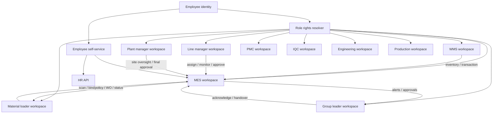

# Unified PDA role and task graph

This is the shared contract for the unified PDA. MES/HR remain authoritative; the PDA
only presents an allowed task and records the operator's action.

## Entity and event contract

| Node | Required identity | Events owned by the authority |
|---|---|---|
| Employee | `employeeId`, role, line/domain | profile, attendance, leave, grievance |
| PDA session | `deviceId`, employee, role, line | login, heartbeat, permission snapshot |
| Work order | `woId`, line, machine, active flag | created, activated, completed, cancelled |
| Material roll | `materialSn`, part number, lot, quantity | issued, scanned, bound, consumed |
| Binding | machine, channel, feeder, material SN | validated, rejected, released |
| Alert | eventId, source, severity, recipients | raised, acknowledged, resolved, escalated |

## Ralph loop stop rule

Each change runs this loop before it is considered complete:

1. Inspect the current screen, route, API and tests.
2. Change one bounded slice using shared UI tokens.
3. Run unit tests and build the affected variant.
4. Check the failure, empty, offline and unauthorized states.
5. Repeat only while a required acceptance gate is failing; stop when all gates pass.

The current PDA acceptance gates are: role boundary, HR/MES API sync, 48dp actions,
visible processing/error feedback, and a successful `UnifiedManagement` build.
